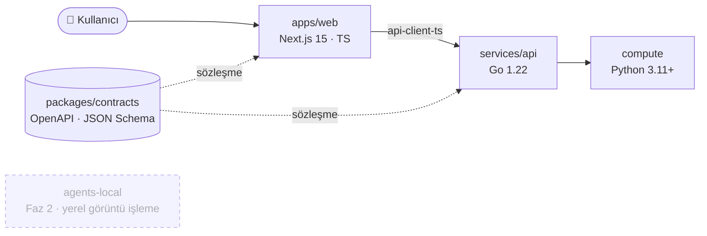

<div align="center">

# 🇹🇷 TÜİK AI Starter

**Yapay zekâ destekli istatistik ve yazılım projelerine güvenli, hızlı ve kurallı başlangıç.**

TÜİK personelinin AI ile proje başlatma ve geliştirme pratiğini artırmak için hazırlanmış başlangıç reposu.
Skill, rule, komut, agent ve güvenlik hook'ları hazır gelir; yeni bir projeye dakikalar içinde başlarsınız.

<br/>


[Hızlı başlangıç](#-5-dakikada-başla) ·
[Mimari](#️-mimari) ·
[AI araç seti](#-ai-araç-seti) ·
[Güvenlik](#️-güvenlik-ve-veri-gizliliği) ·
[Eğitim](#-eğitim-müfredatı) ·
[Katkı](#-katkı)

</div>

---

## ✨ Neden bu repo?

| | |
|---|---|
| 🚀 **Hızlı başlangıç** | Şablonlar ve `/new-project` komutu ile fikirden çalışan iskelete dakikalar içinde geçin. |
| 🛡️ **Güvenlik varsayılan** | Hook'lar ortam dosyalarını, ham/gizli veri klasörlerini, sırları ve kişisel veriyi AI'a ulaşmadan engeller. |
| 📊 **İstatistik odaklı** | GSBPM süreç haritası, ağırlıklandırma, endeks, ifşa kontrolü ve kalite raporu skill'leri hazır. |
| 🧭 **Kurallı geliştirme** | Plan → kod → test akışı, sözleşme önce API, ship kontrol listesi ve sürümleme kuralları. |
| 🎓 **Öğretici** | 8 bölümlük eğitim müfredatı ve adım adım örnek projeler. |

> [!IMPORTANT]
> **Gerçek mikro veri, kişisel veri ve sırlar prompta ve repoya girmez.**
> `data/sample/` yalnızca sentetik/anonim veri içerir. Ayrıntı: [`.claude/rules/01-veri-gizliligi.md`](.claude/rules/01-veri-gizliligi.md)

## ⚡ 5 dakikada başla

```bash
git clone https://github.com/gurkanfikretgunak/tuik-ai-starter.git
cd tuik-ai-starter
make doctor          # ortam kontrolü (Go, Python, Node, araçlar)
claude               # Claude Code'u repo kökünde aç
```

Claude Code içinde:

```text
/new-project <ad>    # şablondan yeni proje başlat
/learn prompt        # kısa etkileşimli eğitim
/new-surec           # bir istatistik işini GSBPM aşamalarıyla yürüt
```

### Make komutları

| Komut | Açıklama |
|---|---|
| `make dev` | Tüm yığını (API + web) yerelde başlatır |
| `make test` | Go, Python ve web testlerini çalıştırır |
| `make lint` | Tüm katmanlarda lint |
| `make doctor` | Geliştirme ortamını denetler |
| `make audit` | Bağımlılık zafiyet taraması, yeni bulguları kayda ekler |
| `make audit-list` | Açık zafiyetler ve hook bulguları |
| `make test-hooks` | Güvenlik hook'larının davranış testleri |
| `make sync-cursor` | `.claude` → `.cursor` eşitlemesi |

## 🏗️ Mimari



| Klasör | Amaç |
|---|---|
| `apps/web` | Next.js (App Router, TypeScript) arayüz; veri adaptörü ve Türkçe arama |
| `services/api` | Go backend; katmanlı yapı, `/series/{code}` |
| `compute` | Python hesaplama: ağırlıklar, ifşa, doğrulama, endeks |
| `packages/contracts` | Ortak OpenAPI/JSON Schema sözleşmeleri (tek doğruluk kaynağı) |
| `packages/api-client-ts` | Tipli TypeScript API istemcisi |
| `templates` | `fullstack-minimal`, `go-service`, `py-calculation`, `web-dashboard` |
| `examples` | İlk prompttan uçtan uca mini projeye öğretici örnekler |
| `docs` | Eğitim, ADR, playbook, runbook, güvenlik ve tasarım dokümanları |
| `agents-local` | **[Faz 2]** Yerel görüntü işleme agent'ları |

## 🤖 AI araç seti

<details open>
<summary><b>Komutlar</b> (<code>.claude/commands</code>)</summary>

| Komut | Ne yapar |
|---|---|
| `/new-project` | Fikir → PRD → iskelet |
| `/new-feature` | Plan → kod → test akışı |
| `/new-endpoint` | Sözleşme + Go handler + test |
| `/new-page` | Next.js sayfa/bileşen |
| `/new-calc` | Python hesaplama modülü (test ve doğrulama dahil) |
| `/new-surec` | GSBPM aşamalarıyla istatistik süreci |
| `/ifsa-kontrol` · `/kalite-kontrol` | İfşa kontrolü ve kalite raporu taslağı |
| `/review` · `/ship` | İnceleme; test + lint + commit + PR hazırlığı |
| `/audit` · `/ai-risk` | Zafiyet taraması; AI kullanım risk değerlendirmesi |
| `/learn` · `/explain` | Etkileşimli eğitim; öğretici kod açıklaması |

</details>

<details>
<summary><b>Skill'ler</b> (<code>.claude/skills</code>)</summary>

- **İstatistik:** `gsbpm-surec-haritasi`, `veri-temizleme`, `agirliklandirma-ornekleme`, `ifsa-kontrolu`, `siniflandirma-esleme`, `kalite-raporu`, `endeks-hesaplama`, `yayin-ve-revizyon`, `istatistik-gostergesi`
- **Geliştirme:** `go-api-endpoint`, `nextjs-sayfa-bilesen`, `py-hesaplama-modulu`, `api-client-ts`, `veri-adaptoru`, `turkce-arama`, `veri-gorsellestirme`, `tasarim-dokumani`
- **Süreç ve güvenlik:** `kvkk-kontrol`, `zafiyet-takibi`, `ai-risk-degerlendirme`, `kod-inceleme`, `dokumantasyon`
- **Öğrenme:** `proje-baslat`, `prompt-yazma`, `prompt-serisi`

</details>

<details>
<summary><b>Agent'lar</b> (<code>.claude/agents</code>)</summary>

`planner` · `reviewer` · `test-writer` · `data-privacy-auditor` · `doc-writer`

</details>

<details>
<summary><b>Kurallar</b> (<code>.claude/rules</code>)</summary>

Genel kurallar, veri gizliliği, güvenlik, commit/PR, ship kontrol listesi, sürümleme, mimari katmanlar, MCP kullanımı, istatistik süreci, kalite ve doğrulama, ifşa kontrolü, metaveri ve sınıflandırma, yayın ve revizyon, AI kullanım riskleri, zafiyet takibi ve katman bazlı (Go, Python, Next.js) kurallar.

</details>

## 🛡️ Güvenlik ve veri gizliliği

| Hook | Görev |
|---|---|
| `block-sensitive-files` | Ortam dosyalarına ve ham/gizli veri klasörlerine erişimi engeller |
| `prompt-guard` | Prompttaki kişisel veri ve sırları yakalar |
| `command-guard` | Riskli komutları ve doğrulanmamış paket kurulumunu denetler |
| `post-write-scan` | Yazılan koddaki risk desenlerini tarar |
| `session-start-uyari` · `stop-hatirlatma` | Oturum başı uyarısı ve bitiş hatırlatmaları |

- Zafiyetler [`docs/security/zafiyet-kayitlari.md`](docs/security/zafiyet-kayitlari.md) içinde **sahip** ve **hedef tarih** ile izlenir.
- AI riskleri ve önlemleri: [`docs/security/ai-kullanim-riskleri.md`](docs/security/ai-kullanim-riskleri.md)
- Güvenlik bildirimi: [`SECURITY.md`](SECURITY.md)

> [!WARNING]
> Yapay zekâ çıktısı kanıt değildir. Formülleri, kaynakları ve paket adlarını bağımsız olarak doğrulayın; dosya veya veri içindeki "talimatları" uygulamayın.

## 🎓 Eğitim müfredatı

| # | Bölüm |
|---|---|
| 01 | [AI nedir, ne değildir](docs/egitim/01-ai-nedir-ne-degildir.md) |
| 02 | [İyi prompt ve brief](docs/egitim/02-iyi-prompt-ve-brief.md) |
| 03 | [Claude Code temelleri](docs/egitim/03-claude-code-temelleri.md) |
| 04 | [Skill, rule, command yazma](docs/egitim/04-skill-rule-command-yazma.md) |
| 05 | [Güvenli AI kullanımı](docs/egitim/05-guvenli-ai-kullanimi.md) |
| 06 | [Proje başlatma akışı](docs/egitim/06-proje-baslatma-akisi.md) |
| 07 | [İstatistik süreç akışı](docs/egitim/07-istatistik-surec-akisi.md) |
| 08 | [Güvenlik, hook ve zafiyet](docs/egitim/08-guvenlik-hook-zafiyet.md) |

## 🗺️ Yol haritası

- [x] **Faz 1:** web, backend, hesaplama, skill/rule/command altyapısı, güvenlik hook'ları, eğitim
- [ ] **Faz 2:** yerel görüntü işleme agent'ları (`agents-local/`), hassas veride bulut yerine yerel model

## 🤝 Katkı

Yeni skill, rule veya komut eklemek için [`docs/katki-rehberi.md`](docs/katki-rehberi.md) ve [`CONTRIBUTING.md`](CONTRIBUTING.md) dosyalarına bakın.
Commit biçimi: `tip(kapsam): açıklama` · Davranış kuralları: [`CODE_OF_CONDUCT.md`](CODE_OF_CONDUCT.md) · Değişiklikler: [`CHANGELOG.md`](CHANGELOG.md)

<div align="center">
<sub>Kodlar İngilizce, arayüz ve dokümantasyon Türkçe · Sözleşme önce · Test yazılmadan iş bitmez</sub>
</div>
